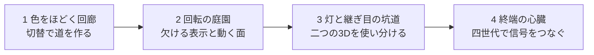

# Console Chaos — 4ステージ体験版企画書

作成日: 2026-10-02（日本時間）

対象: `apps/console-chaos` / Engine `main`・`558fae0`

位置づけ: **初回15〜30分で完結するデモの企画案**。以下の4ステージは未実装。現状調査と実行検証を踏まえ、制作する内容と先に解決する問題を定義する。

変更箇所、作業の依存関係、タスク別の受入条件は[実装計画書](development/FOUR_STAGE_IMPLEMENTATION_PLAN.md)を参照。

## 1. 作る体験

**同じ世界の「映り方」を選び、道を発見して進む謎解きアクション。**

廃棄されたテレビの中に閉じ込められた、桃色の髪を持つデータ生命体が主人公。四つのチャンネルを往復して、途切れた信号をつなぎ、ハートの形をした出口を開く。既存の主人公、浮島、ツタ、石造りの門を活かす。

プレイヤーに持ち帰ってほしい発見は、次の四つ。

- 少ない色や欠ける表示にも、道を見つける力がある。
- 一枚の絵を大きく動かすだけでも、世界が動くような体験になる。
- 奥行きが増えると裏へ回れる。その一方、不安定な描画にも使い道がある。
- 安定した奥行きと動く光があれば、暗闇の形を読み取れる。

古い世代を卒業して新しい世代に固定する進行にはしない。**新しい見え方を知った後で、古い見え方に戻る判断**を気持ちよくする。

| 項目 | 方針 |
| --- | --- |
| ジャンル | 探索と移動・ジャンプを中心とした謎解きアクション |
| 規模 | 4ステージ。初回15〜30分、中心目標20〜25分 |
| 対象 | PCブラウザ。専門的な技術知識は前提にしない |
| 基本操作 | 移動、ジャンプ、CH 1〜4の切替、任意のヒント |
| アクションの役割 | 発見した道を、自分で渡る・乗る・回り込むこと |
| 難度 | 安全に比較してから行動できる。落下は短い復帰で再挑戦 |
| 物語 | 導入と各ステージの一文、最後の短い帰還。長い会話やカットシーンは置かない |

時間は設計目標であり、初見プレイヤーの測定結果ではない。既存リプレイの速さからプレイ時間を推定しない。

## 2. 現状と、この企画で変える範囲

現状は、6種類のパズルを1本の `area1` に並べた垂直スライス。252要素、8区画、8チェックポイントと1ゴールがある。`mini` と `puzzle_lab` は検証用で、完成した別ステージではない。

切替、2D/3Dの衝突解釈、移動・ジャンプ、短い落下復帰、段階ヒント、世代別キャラクターと音楽は再利用できる。一方、4ステージのロードと進行、ゲーム進行の保存、必須装置を解いて出口を開く仕組みは未実装。攻撃の基礎はあるが、敵との戦闘やボスが完成しているわけではない。

調査で確認した重要な問題は以下。詳しい根拠と再現結果は [現状調査・検証記録](development/FOUR_STAGE_RESEARCH.md) にまとめた。

| 問題 | 企画への影響 | 制作方針 |
| --- | --- | --- |
| 現在は謎を解かなくてもゴール接触でクリアできる | 世代の使い分けが、進むための行為にならない | 装置の成果を出口の開閉へ接続する |
| CH 1で暗い通路を直進し、CH 3でゴールへ回れば、CH 4なしで終盤を抜けられる | 光の便利さを体験せず終われる | 光で見つけるだけでなく、光を当てて信号を復旧する装置を加える |
| 「回る床」は画面アフィン面APIを使っていない | 企画上の技術の見せ場が画面に出ていない | 第2ステージの制作前に、面の描画と乗り移りを試作する |
| CH 3の通れる継ぎ目は、実際の描画の破れ方と自動的に同期していない | 見えていない穴を通れても、技術を理解しにくい | 読める継ぎ目と通れる場所を一致させる |
| カメラと移動軸が切替で変わる | 同じ場所へ立っていても別の場所に感じやすい | 共通の目印、安全な切替地点、切替後の進行方向を整える |

既存の [GAME_PLAN](development/GAME_PLAN.md) は2〜3時間・チュートリアル＋6エリアの本編案。このデモでは「音」「入力」の独立ステージを作らず、各場面で差を感じさせる。強制切替と4層ボスは本編候補に残し、デモの完成条件から外す。

## 3. 全編を支える約束

### 切替は、自分で試せる

全ステージで四つのチャンネルを最初から選べる。切替の消費資源や回数制限は設けない。序盤のステージは見せ場を1〜2種類に絞り、全チャンネルを毎回順番に使わせない。最後のステージで四つの役割をまとめる。

通常の切替は現在の約0.35秒を基本とする。安全な岸や比較台から切り替えられる配置を優先し、空中での高速切替を攻略必須にしない。切替中の無敵は既存機能だが、落下や足場の移動を防ぐ保証ではないため、別に安全性を検証する。

### 一つの場所を、見比べられる

同じ門、柱、ツタ、紋章を全チャンネルの共通の目印にする。世代の切替とステージの美術テーマの変更を同時に行わない。形状や配置の関係を追えることを、画面の派手さより優先する。

世界は単一の3D座標を持つ。CH 1・2では奥行きを潰した衝突解釈、CH 3・4では奥行きのある衝突解釈を使う。色で橋がまとまる、描画の継ぎ目を通るといった挙動は、**この世界の信号装置の規則**として見せる。実際のゲーム機の表示制限が物理を変える、という説明にはしない。

### 観察したことが、行動と結果へつながる

各課題は「見比べる → 違いを発見する → 渡る・乗る・回り込む → 装置が復旧する」の短い流れにする。CHを選んだ回数や滞在時間だけでは達成にしない。

装置の復旧は通路、光る導線、門の一部の変化で返す。数字の解決カウントだけに頼らない。F-1の細いツタを3Dで渡るような、筋の通った別解は認める。

## 4. 四つのステージ

| ステージ | 初回目安 | 主な課題 | 身につける判断 |
| --- | --- | --- | --- |
| 1 色をほどく回廊 | 3〜5分 | 色の潰れ、壁の裏側 | 見やすい世代と、進みやすい世代は違う |
| 2 回転の庭園 | 4〜6分 | ちらつきの隙間、回る床 | 表示の欠落を情報にし、面の動きに乗る |
| 3 灯と継ぎ目の坑道 | 4〜6分 | ソートの継ぎ目、暗闇と松明 | 不安定な3Dと、光のある3Dを往復する |
| 4 終端の心臓 | 4〜6分 | 既習ルールを一つの装置へ統合 | 世代を道具として選び、最後まで自分でつなぐ |

中心値は4＋5＋5＋5分。導入とリザルトを含め約21〜22分を狙う。初回の失敗込みで30分を超えるなら、区間数と移動距離を削る。新しい謎の種類を足して調整しない。

### ステージ1 — 色をほどく回廊

**「色が減ったら、道が増えた。」**

明るい浮島と二本のツタ。遠くにハートの門を見せ、行き先を最初から分かるようにする。最初の30〜45秒は落下しない足場で移動・ジャンプ・切替を試せる。四世代で同じ主人公と門を見ることを促すが、操作済みチャンネルのチェックリストは出さない。

| 流れ | プレイヤーの行動 | 見せるもの |
| --- | --- | --- |
| 二本のツタを見る | CH 2で緑と黄緑、CH 3・4で奥行きの分かれ方を観察 | 色と次元の差 |
| 谷を渡る | CH 1で太い橋にまとまることを発見し、歩いて渡る | 色の潰れが行動を楽にする。3Dの細いツタを選ぶ別解も残す |
| 壁の裏へ回る | 2Dでは塞がる壁を、CH 3または4で迂回してスイッチへ触れる | 奥行きが増えると、裏側に道がある |
| 門へ進む | 復旧した導線を追い、開いた出口を渡る | 観察と移動が進行へ結びついた結果 |

既存F-1とP1-1を短く配置し直す。スイッチと出口を接続する部分は追加実装。「CH 1が常に正解」「CH 3だけが3Dの正解」とは教えない。

**確認基準:** 初見の人が最初の谷をヒントなしで試し、「色がまとまったので渡りやすくなった」と説明できる。壁の裏のスイッチが、CH 3と4の両方から読める。

### ステージ2 — 回転の庭園

**「全部見えるより、欠けて見える方が分かることもある。」**

雲と滝のある庭園に、群れの幕と、大きな円形の床を配置する。小さな効果を隅で見せず、主人公の進路を囲む大きさで見せる。

最初の岸から、幕の奥にある灯と踏み石を同じ画面で見せる。CH 1で幕が欠けると、正解石の上の灯が見える。観察はCH 1、ジャンプは自分が使いやすい世代、という組合せを許す。現状はCH 1での台座接触だけが解決になるため、達成条件を「経路を渡って信号を復旧した成果」へ変更する。消えた群れの当たり判定を消すルールは使わない。

次にCH 2で、大きな床の模様が回転・拡縮し、島が岸へ近づく。半透明の踏み台から飛び移り、島に乗って運ばれる。固定した門・外周の柱と、動く床・島を同時に見せて、「カメラが回っただけ」に見せない。

**この見せ場は優先試作。** エンジンの画面アフィン面APIを実際にアプリへ接続し、見た島の位置と乗れる位置を一致させる。現在の真横カメラでは水平面が線に潰れるため、まず画面アフィン合成とXYの当たり判定に共通の座標対応を設ける案を試す。見下ろす構図も比較候補だが、現行CH 2はZを無視する物理なので、カメラだけでは成立しない。移動・衝突の対応も含めて検証してから採用する。背景だけ回り、当たり判定が別の位置へ行く状態では採用しない。

切替で島が向こう岸へ瞬間移動する現状も改善する。途中でCH 2を離れる場合は、全世代で共有する現在の位相で停止するなど、プレイヤーが予測できる挙動を選ぶ。停止した島を他世代で足場として使う別解は認めるが、動かすにはCH 2が必要、という役割を保つ。自由切替を禁止して帳尻を合わせない。

F-2の正解は初回デモでは同じチェックポイント内で保持し、失敗後も学んだ道を試せるようにする。現状の「落下のたびに正解が変わる」仕様からの変更点として扱う。

**確認基準:** 灯と石の対応を安全な岸から読める。CH 2の動く面が画面の中央で明確に見える。乗り移りの成功機会が短すぎず、失敗しても長く待たされない。

### ステージ3 — 灯と継ぎ目の坑道

**「きれいに映ると閉じる道。不安定に映ると開く道。」**

入口は暗くしすぎず、斜めの格子模様を持つ大きな殻を置く。同じ殻をCH 3・4で比較し、CH 3では格子の歪み、頂点の揺れ、継ぎ目の表示矛盾が見え、CH 4では安定して閉じていることを示す。

プレイヤーはCH 3の継ぎ目から入り、核の信号を復旧する。**見えている継ぎ目と、実際に通れる入口を一致させる**。GPUの偶然のソート破れを判定に使わず、共通の仕掛け状態から描画と通行を作る。どこでも壁抜けできる規則にはしない。

その先の暗室はCH 4の携帯光源で足元と通路の折れを照らす。CH 1に戻れば奥行きの折れをまとめて移動できる道も置き、CH 4固定で進むだけの区間にしない。ただし出口を開く刻印は、谷を挟んだ触れられない壁面へ置く。**安全な照射地点へ回り込み、光の届く距離から照らす**ことで復旧させる。暗室を横断しただけ、刻印に接触しただけ、では代わりにならない。

光の判定は、現行の球状点光源と同じ距離条件から作り、刻印の反応と光の届き方を一致させる。刻印と光の間に遮蔽物がない配置に絞る。現行の光に向きや遮蔽はないので、照準を合わせたり、壁の影で光を遮ったりする謎は作らない。最大1点光源と床への投影影で成立する規模に限定し、複数ライトの合成や動く鏡像を使う謎も入れない。

**確認基準:** CH 3と4の差を殻の同じ場所で見分けられる。CH 4の光に歩み寄る意味が分かる。CH 1の投影で暗室を通れても、出口装置の達成条件は飛ばせない。

### ステージ4 — 終端の心臓

**「四つの見え方が、同じ一つの出口につながる。」**

新しい謎の種類を増やさず、巨大なハートの門と、その周囲の一つの信号装置で締める。装置の復旧が、門へ伸びる線と鼓動で見える。既存ルールを4つの短い部分へ再利用するが、4部屋の独立した鍵探しにはしない。

想定する短い循環は、CH 4で接続先を読む → CH 1で線をまとめる → CH 2で中継を運ぶ → CH 3で殻の内側へ接続する → CH 4で出口の刻印を照らす。

| 役割 | 行動 | 完了の証拠 |
| --- | --- | --- |
| CH 1 / 色のまとめ | 二本の信号線を一本へまとめ、合流した導線の先の端子へ到達 | CH 1で一本にまとまった状態でのみ端子がつながり、信号が流れる。F-1の橋の変種で、細い線を渡るだけでは接続しない |
| CH 2 / 動く面 | 回転面の中継島に乗り、届かなかった対岸端子へ到達 | CH 2で動かした中継島が接続位置へ来たとき、中継点と次の導線が点灯 |
| CH 3 / 継ぎ目 | 殻の読める入口から内側へ回り、途切れた導線を復旧 | 内側の核と門の一部が点灯 |
| CH 4 / 動く光 | 照らされて現れた接続先を読み、最後の刻印へ光を届かせる | 刻印が反応し、装置の成果がそろった門が開く |

これは**新しい統合装置の提案**であり、現行6パズルを置くだけでは完成しない。端子の状態と相互接続の設計・試作が必要。導線の合流接続、中継の対岸接続、殻内部の復旧、刻印の照明反応の四つを達成状態として保持し、すべてそろった時だけ出口を開く。配線用の新操作や持ち物システムは作らず、既存の移動・接触と追加の照明判定で完結させる。運搬は島と固定端子の信号接続として表現する。

失敗しても復旧済みの部分は保持する。最後に見せるのは操作速度の試験ではなく、「戻って使い分けられるようになった」達成感。強制切替、残機、攻撃が必要なボスは置かない。

**確認基準:** 四世代それぞれが装置に異なる成果を残す。全世代へ一度切り替えただけでは開かない。プレイヤーが「次にどの部分をつなぐか」を画面から判断できる。

## 5. 技術を、どのように見せるか

技術名を読ませてから解かせるのではなく、**一つの大きな現象を、同じ場所で見比べて使う**。下表の「現在」は実装監査に基づく。「追加」は制作・検証が必要な部分。

| 世代 | 画面で分かる現象 | 体験にする方法 | 現在と追加 |
| --- | --- | --- | --- |
| CH 1 | 色の潰れ、粗い輪郭、群れの欠け | 二本のツタをまとめる。欠けた幕から灯を読む | 現在: 54色系・16pxブロック量子化と走査線制限。追加: 成果と門の接続 |
| CH 2 | 色の分離、半透明、大きな面の回転・拡縮 | 門と外周を固定して床の動きを見せ、島へ乗る | 色量子化・加算半値の合成は使用済み。画面アフィン面は接続が必要 |
| CH 3 | 3Dの裏側、格子の歪み、揺れ、重なりの矛盾 | 読める継ぎ目に入る。大きい格子と交差面をCH 4と比較 | 描画機能は使用済み。入口の視認性と通行の一致を整える |
| CH 4 | 安定した奥行き、明暗、動く光と床の影 | 暗い板の縁と刻印に近づき、照らす | depthと携帯点光源は使用済み。刻印の照明条件は追加 |

現在のコードはCH 1の全画面25色上限、CH 2の256色上限を強制していない。設定に数値があることを、実装済みの保証にはしない。反射はエンジンに経路があるが本アプリでは未使用。デモの必須機能に反射・ラスタ効果を追加しない。

これは実機のエミュレーションではなく、世代の技術を題材にした独自表現。BRR/ADPCMなどの内部名も、正確な実機音源の再現を約束するためには使わない。

### 主人公、音、入力も比較の手掛かりにする

- 主人公のシルエット、桃色の髪、ハートの意匠は全世代で共通。spriteから3Dへ変わっても、別人にしない。
- 既存の同一曲・四編曲・拍を保つ切替を使い、同じ旋律の音色と厚みを感じさせる。技術デモ用に別曲へ突然変えない。
- ステージ1の安全な区間で移動の粒度、後の3D区間で奥行きと微調整を感じさせる。感圧、振動、自由カメラを完成済みの操作として紹介しない。
- 聴き分けやゲームパッド固有機能をクリア必須にしない。無音・キーボードでも同じ成果へ到達できる。
- 解いた後の任意の観察ノートに「少ない色」「表示の欠け」「回る面」「奥行き」「動く光」を一文で記す。内部IDやレンダラの説明をゲーム中の指示に混ぜない。

## 6. 遊びやすさと美術

各課題の手前に、安全な観察場所とチェックポイントを置く。落下後は直前の課題へ短く戻り、ステージ全体や完成した装置をやり直させない。最終装置も部分ごとに成果を保持する。

現在の自動ヒントは3・5・7分で、1ステージ3〜6分のデモには遅い。初回は、進展がない45〜60秒で見る場所、90〜120秒で試す操作を示す設定を試作する。直接の解法は引き続きHで求められるようにする。これらの秒数は試遊で調整する。

色だけで正解を区別しない。ツタの太さ、端子の形、石と灯の縦の対応、刻印の輪郭、導線の動きも使う。CRTの曲がりやモアレが手掛かりを壊さないよう、既存の表示切替で読みやすさを検査する。

美術は既存の浮島・草・砂岩・滝・門を中心に、明るい回廊 → 庭園 → 暗い坑道 → 明るく復旧する終端へ展開する。同じステージの四世代間では、目標や装置の配置・輪郭を保つ。まず既存素材で遊びを作り、新規素材は技術の比較を助ける大きな格子、端子、刻印へ絞る。

## 7. 制作順と完成ゲート

| 順番 | 作る・直すもの | 次へ進む条件 |
| --- | --- | --- |
| M0 攻略と成果の接続 | 必須装置の状態、出口の開閉、迂回検証、読める継ぎ目 | 謎未達成のゴール接触やCH 4なしの暗室横断で、そのステージをクリアできない。正当な別解は残る |
| M1 最初の3〜5分 | ステージ1を短く仕上げ、切替の操作・目印・カメラを整える | 初見で「切替を使う理由」が伝わる。長い待ちや同じ場所の迷走がない |
| M2 CH 2の見せ場 | 画面アフィン面、島の位置との同期、途中切替の安全性 | 回る面が見え、操作方向と接触が見た位置に合う。奥行きの投影で別の島へ誤接触せず、切替で突然飛ばされない。停止した島を他世代で使う場合も成果判定が一貫する。成立するまでは第2ステージを完成扱いにしない |
| M3 二つの3D | 殻の比較、携帯光、刻印の照明反応 | 見える入口と通れる入口が一致する。光を能動的に使う意味が分かる |
| M4 四ステージと終端 | ステージロード、配置インスタンス、部分進行、再挑戦・簡単な復帰保存、統合装置 | タイトルから4ステージを通し、結末まで到達できる |
| M5 初見調整 | 時間、ヒント、ジャンプ、待ち時間、画面の読みやすさ | 15〜30分と各世代の体験目標を、人の試遊で確認する |

パズルは現在、種類IDと固定のentity名で結びついている。同じ仕掛けの短縮版や最終ステージへの再配置には、**種類と配置インスタンス、寸法・周期などの設定を分ける作業**が必要。例えばF-2の「10枚中4枚」はコード固定なので、レベルJSONの編集だけで短縮できるとは見積もらない。

初期版はステージ到達と部分装置の状態を同じセッションで保持し、M4で簡単なローカル復帰保存を追加する。既存の試遊記録の保存は、ゲーム進行の保存の代わりにはならない。

## 8. 何を検証して採用するか

### 実装・画面の検証

同じ地点の世代比較、描画command、衝突と装置の状態をそれぞれ見る。見た目があること、ルールが動くこと、プレイヤーに伝わることを混同しない。

| 対象 | 必要な確認 |
| --- | --- |
| 切替と投影 | 安全地点と移動中で切替。押し出し、Z吸着、落下、移動方向の変化が予測できる |
| 色と欠け | 同じツタと幕を各CHで比較。観察場所から必要な形と灯が読める |
| 回る面 | アプリが画面アフィン面commandを出す。格子・島・プレイヤーの位置が共通の位相から一致する |
| 継ぎ目 | 複数の観察位置で入口が見え、そこだけ通れる。CH 4では閉じる |
| 光 | 光の範囲と刻印の反応が一致する。他世代の通り抜けや単なる接触では達成しない |
| 進行 | 必須装置未達成、落下、途中再開、正当な別解、全4ステージ踏破を検査 |

### 初見試遊

5〜8名を目安に、キーボード中心のプレイヤーを含めて試す。現在の外部初見試遊は未実施。以下は採用判断の目安で、既に達成した評価ではない。

- 目標時間: 初回15〜30分。中央値20〜25分を目指す。
- 最初の発見: 3分以内に、世代を変えて「渡りやすくなった／裏へ回れた」を一度経験する。
- 理解: 終了後、少なくとも3世代の役割を、体験した行動と結びつけて説明できる人が8割程度いる。
- 主導権: 切替を「指定キーを押す課題」ではなく、必要な見え方を選ぶ操作として説明できる。
- 操作: 繰り返す落下の原因が、気づかなかったルールなのか、視認性・カメラ・入力の問題なのかを記録する。
- 見せ場: 「回る床」「継ぎ目」「光」を、本人が画面で見つけたかを確認する。

少人数の結果を一般的な統計的保証にしない。30分を超える、CH 4固定になる、課題を説明されないと進めない場合は、最終ステージを追加する前に導入を直す。

## 9. 今回のデモに含めないもの

敵AI・HP・戦闘ボス、強制切替、感圧必須の装置、方向音だけで解く謎、動く世界を映す鏡、精密な影の推理、実機の完全再現、モバイル操作、長い物語は別の検討対象とする。

このデモの価値は、四つの技術を並べた展示で終わらず、**違いを見つけ、選び、身体を動かして、その結果で道をつなぐ**一続きの体験を完成させることにある。
