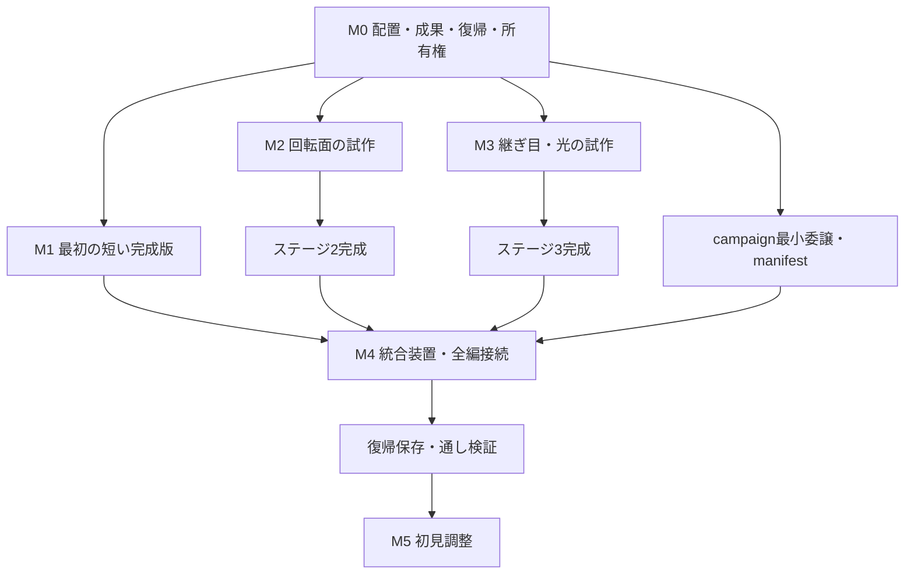

# Console Chaos — 4ステージ体験版実装計画書

作成日: 2026-10-02（日本時間）

対象: `apps/console-chaos` / 調査基準: Engine `main`・`558fae0`

位置づけ: [4ステージ体験版企画書](../FOUR_STAGE_DEMO_PLAN.md)を、変更箇所・依存関係・成果物・受入条件へ分解した計画。**本書のタスクは未着手で、予定の型・ファイル・テストは実装済みを意味しない。** 現状の根拠は[調査・検証記録](FOUR_STAGE_RESEARCH.md)を参照する。

## 1. 完成させるもの

タイトルから四つのステージを順に遊び、初回15〜30分、中心目標20〜25分で結末へ到達するPCブラウザ向けデモを作る。すべてのステージでCH 1〜4を自由に選べる。ステージ1〜3で特徴を学び、ステージ4の一つの信号装置で四世代を使い分ける。

完成条件は、世代ごとの見せ場が実画面に現れ、その違いを使った行動が装置と出口へつながること。ゴール接触だけのクリア、CHの使用回数だけによる達成、見えている入口と通れる入口の不一致を防ぐ。

| ステージ | 主な実装 | 初回目標 |
| --- | --- | --- |
| 1 色をほどく回廊 | F-1の通過成果、P1-1の裏側スイッチ、安全な切替導入 | 3〜5分 |
| 2 回転の庭園 | F-2の情報と達成の分離、道の保持、画面アフィン面と移動島の同期 | 4〜6分 |
| 3 灯と継ぎ目の坑道 | 読める継ぎ目、携帯光の距離判定、接触できない刻印 | 4〜6分 |
| 4 終端の心臓 | 合流・中継・内部復旧・照明の四成果を保持する統合装置 | 4〜6分 |

敵AI、HP、戦闘ボス、配線用の新操作、持ち物、照準、強制切替、感圧必須、動的反射、精密な影、モバイル対応は実装範囲に含めない。既存素材・主人公・移動・ジャンプ・音楽編曲を使い、新規素材は格子、端子、刻印、面の比較用模様へ絞る。

本書と旧[IMPLEMENTATION_PLAN.md](IMPLEMENTATION_PLAN.md)が異なる部分は、本デモには本書を適用する。ゲーム体験の判断は4ステージ企画書を優先し、試作で表現を変更する場合は企画書へ結果を戻す。

## 2. 現状から決める実装方針

| 確認した現状 | 実装方針 |
| --- | --- |
| `GameHost`は一つのmoduleだけを起動し、再initializeを拒否する | 一つのcampaign module内でactive stageの`GameInstance`を入れ替える。ステージごとにhostを再起動しない |
| `Session.dispose()`はlistener解除だけで、worldのplayer・床を破棄しない | セッション所有Entityを記録し、冪等に破棄する。共有world全体を消さない |
| rendererのmanifestは起動時の1レベルから作られる | 小規模デモでは4ステージのasset・geometry manifestを起動前に統合する |
| 状態と固定entity名がパズルの種類IDに結びつく | 種類、配置ID、roleのbinding、設定、成果を分離する |
| 現在の`reset()`は全body・PlayerState・吸着状態まで初期化しない | 新規開始はセッション再生成、落下は明示した一時状態の再構築に分ける |
| F-2の崩れた石はseed変更を契機に戻る | 正解seed保持と一時状態の復旧を別処理にする |
| CH 2の床はXZ公転＋真横カメラで、専用面commandは0 | XY操作を保つ共通変換案を先に試作。カメラだけの変更では完成としない |
| 光は1個の球状点光源で、向き・遮蔽なし | 同じ位置・半径・距離減衰で照明成果を判定し、遮蔽物のない配置へ限定する |

根拠: [GameHost](../../../../packages/engine/src/runtime/game-host.ts)、[session](../../src/gameplay/session.ts)、[起動処理](../../src/engine-bootstrap.ts)、[manifest](../../src/presentation/catalog.ts)、[F-2](../../src/gameplay/puzzles/f2_flicker_gap.ts)、[S-1](../../src/gameplay/puzzles/s1_affine_plane.ts)、[光源](../../../../packages/engine/src/render/lighting.ts)。

企画書M4の「配置インスタンス」「部分進行」「ステージロード」は、最小の契約と独立起動をM0へ前倒しする。M4では4ステージの接続、統合装置、復帰保存を完成させる。M1〜M3を固定名で作ってから再配置する工程を避けるためであり、企画の体験順は変えない。

## 3. コード構造と所有権

### 3.1 変更する場所

パスはアプリからの相対位置。「新規」は予定ファイル。責務を分けるための配置案であり、同じ目的の小さな既存モジュールへまとめてもよい。

| 場所 | 変更・追加する責務 |
| --- | --- |
| `src/level/schema.ts`、`loader.ts` | v1入口を保つ。v2ステージを別の検証・ロード入口へ追加し、共通のscene情報へ正規化 |
| `src/content/stages.ts`（新規）、`stage-schema.ts`（新規） | 4ステージの順序、v2配置・成果・出口・安全地点の定義と参照検査 |
| `src/content/level-adapter.ts` | entities・sectorsをengineのsceneへ渡す。app固有の進行情報はapp側へ残す |
| `src/gameplay/session.ts` | 共通シミュレーション、所有Entity破棄、配置された仕掛けだけの更新、出口条件 |
| `src/gameplay/puzzles/types.ts`、`registry.ts`、6種類の実装 | 配置別context、role binding、設定、一時状態・成果、再試行時の復旧 |
| `src/gameplay/stage-progress.ts`（新規） | 成果の正本、冪等な付与、出口条件、復元時の適用 |
| `src/gameplay/campaign.ts`（新規）、`src/app.ts`、`src/config/actions.ts` | active stage instanceへの委譲、遷移境界、ステージ生成・破棄、押しっぱなし入力の抑制 |
| `src/gameplay/save.ts` | version付き保存codecとstorage wrapper。進行を保存する |
| `src/presentation/frame.ts`、`catalog.ts` | 共通仕掛け状態の表示、面command、4ステージmanifest統合 |
| `src/presentation/affine-garden.ts`（新規） | 共通の盤変換から内部pixel・UV・島表示を作る |
| `src/render/material.ts` | 固定entity名への素材overrideをroleや種別へ移す。旧名の対応は保持 |
| `src/engine-bootstrap.ts`、`src/ui/game_flow.ts` | campaign起動、途中ステージ完了、次へ、再開、最終リザルト、エラー復帰 |
| `src/gameplay/hints.ts`、`src/ui/hud.ts` | 配置IDで進行を扱う。短編用ヒント設定、未復旧の対象を伝える表示 |
| `src/debug/playtest_log.ts`、`playtest_flow.ts`、`tools/playtest-report.ts` | stage・配置別記録と全編の集計。試遊用質問を通常のリザルトと分離 |
| `public/assets/levels/demo_stage1.json`〜`demo_stage4.json`（新規） | 4ステージのv2データ。単独検証とcampaignの両方で同じデータを使う |
| `tools/check-levels.ts` | v1とv2の検査を分岐し、配置・成果・gate・素材・設定値を検証 |

### 3.2 ステージ切替の手順

campaign moduleだけをhostへ登録し、その内部のactive stageへ`prepareFixedUpdate`・`fixedUpdate`・`buildRenderFrame`を委譲する。現行の`createConsoleChaosModule`を再利用できる単位へ分け、v1の単独起動入口も保つ。

1. 次ステージのデータと素材の準備が完了していることを確認し、遷移を一度だけ予約する。
2. 固定更新の終了境界で進行を確定。入力受付とstage simulationを止め、切替遷移が安定した境界へ進める。
3. 暗転中に旧stage instanceを破棄。世代listener、HUD、試遊listener、所有Entityを解除する。
4. 新しいstage sessionとpresentationを作り、成果・チェックポイントを復元する。旧stageと新stageを同じworldへ同時に生成しない。
5. 入力の押下状態・ジャンプbuffer・投影anchorを初期化し、安全なspawnを描画してから再開する。遷移時に押されていたジャンプ・CH切替等のbuttonは、一度離すまで再発動させない。移動は中立化してから受付を再開する。

host・renderer・入力source・asset manager・audio serviceはcampaignが共有する。stageの破棄でこれらをdisposeしない。二重遷移、二重dispose、戻る操作の連打でも、world・listener・DOMが増え続けないようにする。

ActionMapのresetや再生成だけでは、共有input sourceに残るheld buttonが次stageで新しいpressedになり得る。アプリの入力境界へrelease待ちを設け、keyboard/gamepad両方を検査する。共有engineの押下検出の意味は変えない。

`shouldSimulate`は明示したプレイ状態でだけtrueにする。タイトル、ステージ完了表示、loading、loadError、最終リザルトではfalse。hostはstageを止めても世代遷移を進めるため、旧session listenerが残る間の世代変更と、新session生成の順序を検査する。

初期版は4つの小さなJSONと共通素材を起動前に検証・準備する。素材・geometryはURLとgeometry keyで重複排除し、後のステージや復旧時に初めて未登録geometryが現れないようにする。準備失敗時は再試行できる画面を出し、保存進行を先へ進めない。

## 4. ステージ・仕掛け・成果の契約

### 4.1 v2データと既存資料の扱い

既存`area1`・`mini`・`puzzle_lab`、v1 loader、旧ID、リプレイ、検証シーンは残す。**旧v1のゴール接触やseed方式は検証用の旧仕様として維持し、新デモv2に成果gateと正解保持を適用する。** 旧終盤の迂回再現を新デモへ移植し、そこでクリアが阻止されることを確認する。互換性のために新デモの出口条件を弱めない。

旧reset/R/放置デモの開始、S-1の更新順・時計・seed方式はv1経路へ残す。新規開始の再生成、位相停止、物理前の島更新はv2へ適用する。既存リプレイの結果を新仕様へ合わせて一括更新しない。

v1は既存`loadLevel`、v2は新しい`loadStage`で検証し、内部の共通session核へ必要な設定を渡す。既存のloader戻り値を無条件にunionへ変えない。v2も世界座標は一つの3D位置を正本とし、世代別のlevel座標やcolliderを別々に記録しない。

M0で固定する最小項目:

| 項目 | 契約 |
| --- | --- |
| stage ID | campaign内で一意。content revisionと順序をcatalogで管理 |
| 配置ID | stage内で一意。状態の識別は`stageId + instanceId` |
| 種類 | F-1などの既存family。通常通過と最終接続の違いは明示したvariantで表す |
| role binding | `vineA`、`tiles`、`pivot`、`terminal`などをentity IDへ束縛。必要role欠落はロード失敗 |
| 設定 | 谷幅、石数、正解数、周期、半径、照明閾値など。種類別の型と範囲を検証 |
| 成果 | 配置の行動が完了したときに付与する一意ID。繰り返し付与してもイベントは一度 |
| ヒント対象世代 | 情報が読める・装置を動かせる世代。完了可能世代と区別する |
| 完了可能世代 | variantの実際の成果条件と一致。種類だけの`solvableIn`を全配置へ流用しない |
| 出口 | goal trigger、門のblocker、必要成果IDの集合 |
| 安全地点 | checkpoint ID、位置、復帰可能世代、必要なら停止位相 |

例えば庭園F-2は「幕を読めるのはCH 1」「道を渡る成果は他世代でも成立」。旧`requiredGenerations`の意味を変えてv1の検査を壊すのではなく、v2の情報条件と完了条件を別に検査する。ヒント・catalog・ログも配置IDを状態キー、種類を文面・技術分類のキーにする。

固定名への依存はロジックだけでなく、F-1の素材override、S-1のpivot描画、パズル中心計算にもある。全entityを自由に参照するcontextではなく、配置へ束縛したroleを参照する。定義のmodule-global可変状態は作らず、配置されたinstanceだけを更新する。

### 4.2 成果と出口

`StageProgress`を達成状態の正本にし、導線、端子、門の表示とblockerの実体をそこから決める。クリアには「必要成果がすべて成立」かつ「出口triggerへ到達」の両方を要求する。物理的に門を閉じる処理だけには頼らない。

| ステージ | 必要成果 | 判定上の約束 |
| --- | --- | --- |
| 1 | 谷の通過、裏側スイッチ | CH 1の橋とCH 3・4の細いツタを正当な別解として認める |
| 2 | 灯から示される経路の通過、回転島の中継接続 | F-2は渡るときのCHを限定しない。島を動かす能力と、動かした結果の接続を要求 |
| 3 | 殻内部の復旧、刻印の照明反応 | 2Dで暗室を直進しても、照明成果なしでは出口を開けない |
| 4 | 合流接続、中継接続、内部復旧、照明反応 | 四つを個別に保持。各成果を一つ欠く場合は閉じ、最後の一つで開く |

ステージ4の合流接続は「線を渡った」ではなく、色がまとまった状態の導線と端子の接続。中継接続は「CH 2に切り替えた」ではなく、動かした島の接続位置とプレイヤーの到達。内部復旧と照明も、それぞれの実際の行動で付与する。序盤へ全CH使用条件を追加しない。

## 5. 落下・再試行・保存の仕様

### 5.1 保持する状態と戻す状態

| 操作 | 保持するもの | 再構築するもの |
| --- | --- | --- |
| 落下、現在課題の再試行 | stage進行、復旧済み成果、CP/配置単位の正解seed、安全な停止位相 | プレイヤー、速度、入力buffer、投影anchor、崩れた石・切れたツタ、fade状態 |
| 次ステージへ | 完了stageとcampaign進行 | 次stageの未達成装置と安全なspawn |
| タイトルへ戻る | 保存済みの進行 | active stageの一時状態を破棄し、再開時に復元 |
| 続きから | 保存snapshot内の進行、CP、seed、成果 | world・body・描画をデータから作り直す |
| 最初から | 設定だけ | 全進行を初期化し、stage1・CH 1から新セッションを作る |

再試行用の`resetTransient`／`onRetry`を種類ごとに用意する。F-2では同じ道seedでも偽石を復旧させ、F-1の失敗で切れたツタも戻す。成果による門の開状態は、その後に再適用する。既存`session.reset()`を完全初期化と見なさない。

道seedはランseed・stage・配置・checkpointから決定的に生成し、復帰回数から切り離す。他の区間で落ちても正解が変わらない。P2-1の廊下も同じデモ方針で保持する。動く装置の再試行は、CPに記録した安全な位相とプレイヤー位置を組にして戻し、復旧済みの接続成果を消さない。

### 5.2 簡単なローカル復帰保存

M0でsnapshotの契約を決め、M4で`save.ts`へ実装する。設定・試遊記録とは別のstorage keyを使う。

- 保存対象: save version、campaign ID/content revision、ランseed、現在/完了stage、CP ID、安定したCH、配置別の成果、道seed、必要な安全位相。
- 保存しないもの: ECS Entity ID、World、Mapそのもの、velocity、入力buffer、投影anchor、切替途中のblend、全body位置。
- 保存契機: CP到達、初回の成果付与、stage完了。固定更新終端のsnapshotを一度書き、毎frameの書き込みはしない。
- stage完了: 完了済みstageと次stageの開始CPを、一貫したsnapshotとしてまとめて保存する。最終stageなら全編完了を保存する。
- 復元: JSON検証 → 安定したCHと安全CPを選ぶ → stage生成 → 成果と装置状態を適用 → 初回の物理・描画 → 入力再開。復元済みの成果音を一斉に鳴らさない。

不明version、別content revision、未知stage/成果、JSON破損、非有限値は復帰用として採用しない。CPだけが見つからない場合は、そのstageの安全spawnへ戻す。storage禁止・quota超過でもプレイは継続し、保存できなかったことを短く表示する。移行用の汎用セーブシステムは作らない。

## 6. 技術の見せ場を成立させる実装

### 6.1 CH 2: 回転面の優先試作

**第一候補は、真横のXY操作を保つ、画面アフィンで描いた大きな回転盤。** 局所2D座標から世界XYへの一つの変換を定め、盤の模様・島の中心・接続端子を同じ状態から作る。現在のXZ公転を見下ろすだけの案は、操作と衝突の対応も変更する必要があり、初回試作では採らない。

水平床そのものを上から眺める構図ではないため、「円形の庭園装置として見えるか」「面の動きに乗ったと感じるか」は試作の採用判断に含める。企画の大きな面の回転・拡縮と乗り移りを満たさなければ、構図案を再検討し、結果を企画書へ戻す。

| 試作項目 | 実装内容 | 採用条件 |
| --- | --- | --- |
| 共通変換 | 固定tickの位相から回転・倍率を求め、局所点を世界XYへ変換する。表示と衝突の別時計を作らない | 島中心と面上の印が一致し、実時間や描画fpsで経路が変わらない |
| 実API接続 | `frame.affineSurfaces`へCH 2用commandを出す。`screenRect`、`uvOrigin`、`uvStepX/Y`は共通変換の逆写像から生成 | commandが非0で、実ブラウザに回転・拡縮が出る |
| pixel対応 | 現在のorthographic cameraとCH 2内部256×224を使ってworld→pixelを計算。画素中心を含める | カメラ引きやviewport変更で表示と接触がずれない。固定32px/worldを描画変換へ決め打ちしない |
| 素材方向 | 非対称な四隅の印で上下・回転方向を確認。manifestの既存flipYを利用 | UVへ二重flipを足さず、島と模様が同じ向きに動く |
| 合成 | 初回は不透明な矩形盤を使い、固定外周を後描きする | 既存surfaceのblend仕様で背景を壊さず読める。円形alpha切抜きを新機能の前提にしない |
| 拡縮 | まず小さい正の倍率範囲を試し、模様と島の中心へ同じ変換を適用。足場AABBは回転させない | 島の中心・接続位置・通れる範囲が一致。小さすぎる足場や高速の接近を作らない |
| 位相と切替 | CH 2が安定した間だけ位相を進め、他CHと遷移中はその位相で停止する | 切替でπへ戻らず、島と乗客が突然対岸へ移動しない |
| 乗客 | groundHit/支持島IDで乗客を特定。島の変位で運んでからplayer physicsを解く | 近いだけの空中プレイヤーを吸着しない。ジャンプで離れた後はcarryしない |

共通写像は、局所点`q`、盤中心`O`、倍率`s`、回転`R(θ)`から `w = O + s R(θ) q` で世界XYを求め、Zは区間の固定値を使う。固定した横視点のカメラ中心`C`、内部寸法`W/H`、`k = H / orthoHeight`なら、pixelは `px = W/2 + k(wx - Cx)`、`py = H/2 - k(wy - Cy)`。面のUVはpixelから局所点への逆写像で作り、`screenRect`の左上と画素中心を含めて[affineUvAt](../../../../packages/engine/src/render/affine/reference.ts)で照合する。

回転のみ・`s=1`を先に通し、次に`0.95〜1.05`程度の小さい拡縮を試す。島と主人公の形は縮めず、島中心と盤上の印の移動を一致させる。これらは採用済みの数値ではない。CRT offの技術確認では0/90/180/270度と倍率両端を観察し、島基準点と印のずれを原則1内部pixel以内、切替による島位置の飛びを0にする目標で検査する。

更新順は「前tickの支持島を読む → 次poseを一度計算 → 島・台座と接地乗客を移動 → 入力/ジャンプ/physics → 新支持を確定 → 成果判定 → 表示snapshot」とする。現在のphysics後の島移動をそのままXY上下運動へ流用しない。高速の上下移動や頭上への挟み込みを避け、動く床との接触を検証する。

既存面API: [frame.ts](../../../../packages/engine/src/render/frame.ts)、[affine参照計算](../../../../packages/engine/src/render/affine/reference.ts)、[アプリframe](../../src/presentation/frame.ts)。背景 → 面 → mesh → 別sprite面 → 世代の量子化・CRTという合成順を踏まえる。

試作ではカメラを固定する。現行`RenderFrame.camera`は一つで、切替の旧新passも共有する。最終版では350msの旧新描画で共通の目印・島を追えるか確認する。単一cameraでは成立しないと確認された場合だけ、世代別cameraをpassへ渡す最小engine拡張を独立タスク化する。現APIのまま二つの異なる構図が自動で一致するとは見積もらない。

停止した島へ他世代で乗る別解は許すが、島を動かすにはCH 2が必要とする。中継成果は動かした島の接続状態と到達から判定し、停止位置への単なる接触だけで成果を飛ばせないようにする。

### 6.2 CH 3: 継ぎ目の共通状態

P1-2の固定collider無効化を、配置が返す`seamOpen`のような読み取り専用状態へまとめる。同じ状態から継ぎ目の見える幅、入口のcollider、核の到達判定を作る。GPUの偶然の破れをreadbackして通行条件にしない。

試作の殻は固定開口を持つ箱・格子パーツと、別entityの閉鎖板で構成する。`seamOpen`から閉鎖板のvisibleと入口colliderを同時に切り替え、残る殻の面にはCH 3のソートを保つ。現行の単一`props_shell`モデルを完成版にも使う場合は、開口を持つ本体と閉鎖板へ分割・再生成する素材作業とmanifest登録が必要。既存shaderだけで任意の穴を開けられるとは扱わない。

大きな格子と交差面でCH 3の歪み・揺れ・重なりを見せ、入口として読める部分だけを通せるようにする。CH 4では同じ殻が安定して閉じる。複数観察地点、カメラ境界、CH 1・2への切替で殻全体を抜けたり、閉じた殻に復帰したりしないか確認する。

### 6.3 CH 4: 光と刻印

携帯光の位置offset・半径・有効条件を共通の設定/状態へまとめ、frameの点光源とCPU判定の両方に渡す。現行offset `[0, 0.6, 0]`・半径7を初期値とし、距離減衰 `max(0, 1 - distance / radius)^2` と刻印の反応閾値を一致させる。

刻印は谷を挟んだ接触できない壁面へ置く。安全な照射地点まで移動して範囲へ入ると反応し、成果を保持する。光源から刻印までを遮らない配置に限定し、方向、壁の遮蔽、複数ライト、shadow mapを追加しない。反応の境界は刻印と導線の見た目で読めるようにする。

CH 1で廊下を横断する経路は残してよいが、携帯光が有効でなければ照明成果を付与しない。復帰と再開でも刻印の成果と出口の状態を保つ。

### 6.4 比較しやすいカメラ・音・ヒント

安全な比較地点、共通の門・柱・紋章、切替後の進行方向をステージ設定へ持たせる。描画だけのために物理座標を別々に作らない。移動方向・視点変更は現在の操作を基準に、ステージ1と庭園で先に確認する。

既存の同一曲・四編曲を使い、CH切替時の拍を保つ。campaignが音楽presenterを共有するか、stage間で一つだけを再生成するかを実装時に一本化し、多重再生を防ぐ。復旧音は成果の初回付与でのみ鳴らす。無音で全編をクリアできる。

ヒントはv2用に設定化し、最初は進展のない45〜60秒で見る場所、90〜120秒で操作候補を出す。対象の成果やCP進展で滞留timerを更新し、loading/タイトル中は進めない。直接解法はHで要求する。文面は配置variantに対応させ、観察CHと渡るCHを混同しない。解決後の任意ノートには現象を一文で残す。

## 7. タスク分解と受入条件

タスクIDは本計画専用。各行をレビュー可能な単位とし、共通基盤の大きな変更を一度に全ステージへ広げない。タスク完了はコード量ではなく、右欄の観測結果で判断する。

### M0 — 成果・配置・復帰の土台

| ID | 作業・主な成果物 | 依存 | 受入条件 |
| --- | --- | --- | --- |
| D0-01 | v2 schema、正規化、4stage catalog、種類/配置/role/設定の契約 | なし | 不明種類、重複配置、欠落role、無効成果/gate、設定範囲外を検出。v1検査も通る |
| D0-02 | 配置別contextと更新、hints/catalog/materialの識別を移行 | D0-01 | 同じ種類を2配置し、片方の破損・成果・ヒントが他方へ漏れない。未配置種類を更新しない |
| D0-03 | StageProgress、冪等成果、出口trigger＋blocker制御 | D0-02 | 未達成のゴール接触でクリアせず、全成果成立後の到達で一度だけクリアする |
| D0-04 | CP/配置seed、resetTransient、安全位相、snapshot契約 | D0-02/03 | 道seed保持と石の復旧が両立。既得成果を落下で失わない |
| D0-05 | 所有Entity破棄、単独stage起動、共通session核 | D0-01/02 | 生成→破棄→再生成で旧床・player・listenerが残らない。v1入口も動く |

M0のgateは新デモの小さい検証配置で確認する。セッションを目的地点へ置く単体検査と、移動入力で出口へ到達する検査を組み合わせる。旧area1の迂回入力を、新デモの対応区間で失敗する回帰ケースへする。

### M1 — ステージ1を短い完成版へ

| ID | 作業・主な成果物 | 依存 | 受入条件 |
| --- | --- | --- | --- |
| D1-01 | `demo_stage1.json`の箱配置。30〜45秒の安全導入、谷、裏側、門 | D0-03/05 | 四CHを安全に比較でき、行き先が見える。CH 3/4で裏へ回れる |
| D1-02 | F-1通過とP1-1復旧、導線と出口を接続 | D1-01、D0-04 | CH 1の太い橋とCH 3/4の細いツタの両方で成果が成立する |
| D1-03 | カメラ、形/太さ、音、短編ヒント、任意ノート | D1-02 | 同じ主人公・門を追え、色や音だけに頼らず進める |
| D1-04 | 正解/別解/未達成迂回のリプレイ、4CH画像、短い初見確認 | D1-03 | 3分以内に切替の利点を発見できるか記録。3〜5分を目標に調整 |

### M2 — 回転面を成立させてステージ2へ

| ID | 作業・主な成果物 | 依存 | 受入条件 |
| --- | --- | --- | --- |
| D2-01 | 単独の盤試作。共通変換、affine command、非対称模様、島 | D0-02/04/05 | 実画面に回転・拡縮が出て、面と島の印が同じ位置で動く |
| D2-02 | 支持島/carry、更新順、位相停止、必要ならcamera拡張の判断 | D2-01 | ジャンプで離れられ、切替で飛ばされず、旧新描画で位置関係を追える |
| D2-03 | F-2の設定化、任意CHの通過成果、同じ道での再試行 | D0-02/03/04 | CH 1で観察し別CHで渡っても成立。落下後の道は同じで偽石は復旧 |
| D2-04 | `demo_stage2.json`、幕/灯/石の比較岸、盤と対岸端子、表示/音/ヒント | D2-02/03 | 投影による誤接触なし。待ちと乗り移りに余裕があり、4〜6分を目指せる |

D2-01/02はM1と並行可能。試作が合格するまでステージ2の美術と長い配置を完成させない。失敗時は共通写像と構図を再検討し、専用面を使わないmesh回転で完成扱いにしない。

### M3 — 二つの3Dをステージ3へ

| ID | 作業・主な成果物 | 依存 | 受入条件 |
| --- | --- | --- | --- |
| D3-01 | 継ぎ目の共通状態と核到達、固定開口＋別閉鎖板の殻、格子の比較配置 | D0-02/03/05 | 見える入口だけ通れ、CH 4では閉じる。複数地点から入口を読める |
| D3-02 | 携帯光の共通設定、距離減衰と刻印の成果判定 | D0-02/03/04 | 光の反応境界が表示と一致し、接触・他CHの直進で代替できない |
| D3-03 | `demo_stage3.json`、暗室、照射地点、CP、表示/音/ヒント | D3-01/02 | 2D横断を許しても必須成果を飛ばせず、光を使う理由が分かる |
| D3-04 | 入口位置/光境界/全CH迂回/復帰の検査と画面比較 | D3-03 | 視認性と操作難度を分けて確認し、4〜6分へ調整 |

D3-01/02の技術試作はM1/M2と並行可能。完成判定にはbrowser観察を含め、状態の単体テストだけでは合格にしない。

### M4 — 統合装置・4ステージ・復帰保存

| ID | 作業・主な成果物 | 依存 | 受入条件 |
| --- | --- | --- | --- |
| D4-01 | `demo_stage4.json`の近接した一つの装置。四成果と導線・門 | D1-02、D2-04、D3-03 | 移動/接触/照明だけで完結し、四成果を一つずつ欠く状態で門が閉じる |
| D4-02 | campaign module、統合manifest、stage完了→次へ→最終リザルト | D0-05、D1-04、D2-04、D3-04、D4-01 | 新規開始から結末まで通常入力で通る。中間stageで全編クリアにならない |
| D4-03 | save codec、storage、続きから、CP/成果/seed/安全位相の復元 | D0-04、D4-02 | 各成果後の落下・reloadで部分進行が残る。破損保存でも新規開始できる |
| D4-04 | 遷移連打/2周/入力保持/素材準備失敗/無音の統合検証 | D4-02/03 | Entity・listener・DOM・audioが増え続けず、保存とstage移行が一貫する |

campaignの最小委譲とmanifest合成はD0-05後に先行できる。4stageの完成を待ってlifecycleを初めて試さない。D4-02は内容の接続と通常UIの完成ゲートとする。

通常起動は完成時に新デモへ向け、既存の明示した検証URLを保つ。開発用stage直接起動は全編クリア記録や通常の復帰保存へ混ぜない。放置デモ機能は既存v1経路を保持し、今回の4stageキャンペーン用自動デモの新規制作は範囲外。

### M5 — 初見で時間と理解を確認

| ID | 作業・主な成果物 | 依存 | 受入条件 |
| --- | --- | --- | --- |
| D5-01 | stage/配置別の試遊記録、滞留・ヒント・復帰・切替の集計 | D4-02 | タイトル/loadingの時間を遊んだ時間と分け、全編と区間の両方を集計 |
| D5-02 | 5〜8名の初見試遊。キーボードを含め、終了後に役割を聞く | D4-04、D5-01 | 15〜30分、中央値20〜25分、3分以内の最初の進展を目標として評価 |
| D5-03 | 視認性・操作・待ち・移動・ヒントの原因別調整と再確認 | D5-02 | 3世代以上の役割を行動と結びつけられる人が8割程度。未達なら再調整 |

少人数の結果は統計的保証にしない。全体が30分を超えたら、長い移動、周期待ち、同じ落下を減らす。分からない場合は目印、対応関係、カメラ、ヒントを直す。四世代の役割を削って時間を合わせず、新しい謎で水増ししない。

## 8. 依存関係とレビュー単位



レビューは「schema/instance」「成果と復帰」「所有権と単独起動」「stage1」「盤の試作」「stage2」「継ぎ目と光/stage3」「stage4」「campaign/save」「初見調整」を目安に分ける。共有する`session.ts`・`presentation/frame.ts`の並行編集は避け、契約の変更を先に合流する。

最大の不確実性はD2-01/02。日程は、回転面の座標対応・合成・切替を試作で確認してから、残る配置と美術の工数を見直す。担当人数や開発速度が未確定のため、本書では暦日や実証されていない工数を約束しない。

## 9. 検証方法と実行コマンド

### 9.1 自動検査

予定の主要検査を以下に示す。実装を写したassertではなく、誤クリア・進行喪失・状態の混線・表示と衝突の不一致を捕まえるケースに絞る。

| 対象 | 検査する挙動 |
| --- | --- |
| schema/配置 | role・成果参照・設定値・同種2配置・未知種類。配置されていない仕掛けが動かない |
| stage gate | 各成果未達でgoal接触しても未クリア。全成立＋到達でクリア。stage1の正当な別解 |
| 再試行 | F-2の道保持と偽石復旧、切れたツタの復旧、成果保持、CPの安全位置 |
| 回転盤 | 同じseed/入力で同じphase/位置。接地carry、ジャンプ離脱、遷移停止、停止島の他CH利用 |
| 継ぎ目/光 | 入口の状態と通行、点光の反応境界、他CHの迂回、接触不能の刻印 |
| stage4 | 四成果の個別取得、欠落、取得後の落下/復元、許可した取得順、切替だけでは未達 |
| campaign | 新規→4stage→結末、途中完了、連打、破棄、2周、押しっぱなし入力の持越し |
| save | round-trip、version/revision不一致、破損、未知CP、storage例外、切替中の安全snapshot |

既存[production-host検査](../../tests/e2e)はVitestと手動host/recording rendererを使うシミュレーション検査で、実ブラウザGPUの確認ではない。新campaignのlifecycleもこの方法で検査し、ブラウザ検証を別に行う。

リポジトリルートから、変更に関係する既存/新規のテストファイルを選んで実行する。新しいテスト名は実装時に決める。各レビュー単位の終わりにはアプリの既存一括検査を使う:

```sh
npm run verify --workspace apps/console-chaos
```

engineの型やrendererを変更した場合は、公開packageのbuildを更新し、その変更に関係するengineテストとlintを先に実行する:

```sh
npm run build --workspace packages/engine
npm run lint --workspace packages/engine
npm run test --workspace packages/engine
```

共有engineの変更が必要になった場合だけ、asset-pipeline sampleとConsoleChaosRacingの関連するbuild/切替/描画回帰も確認する。engineの既存APIで成立するなら、ゲームのために他アプリの公開契約を変えない。

### 9.2 実ブラウザと初見試遊

各stageの安全な同地点を四CHで観察し、入口、ツタ、幕/灯、盤、刻印が読めるか確認する。移動島は同じ固定tick/phaseの記録を取り、affine commandが非0、島と印の位置が一致、切替中も読めることを確かめる。CRT full/light/off、moire/flatten切替、無音、キーボード、異なるviewportで検査する。

ブラウザは既存Chromium/Playwright環境を利用し、再現用の操作・phase・seed・画面条件を記録する。software WebGLの画像確認と実機GPUの性能を分け、性能は対象PCで測定する。性能悪化時は装飾・描画数を減らし、手掛かりを消さない。

通常入力による全編通しと、部分成果後の落下/reloadを確認する。開発APIで目的地点へ配置する観察だけでは、到達可能性や全編完走を合格にしない。

初見記録は全編/各stage/各課題の時間、最初の進展時刻、ヒント段階、復帰/切替、待ち、取得成果、入力deviceを対象にする。観察者は「現象に気づかない」「次の対象が分からない」「操作が難しい」「待ちが長い」を分ける。終了後、誘導せず各世代の役割と戻った理由を聞く。

技術検証のログ・画像はGit管理外の`Docs/measurements/`へ保存する。試遊者ごとの生ログは公開対象外の場所で管理し、リポジトリには人数、環境、匿名集計と判定だけを反映する。安定した検証結果は[VALIDATION.md](../VALIDATION.md)、試遊手順は[PLAYTEST.md](../PLAYTEST.md)へ記録する。自動リプレイの秒数を初回15〜30分の証拠にしない。

## 10. 着手順と残る判断

**最初の作業はD0-01 → D0-02 → D0-03。** 一つの小さいv2配置で、種類と配置が分離し、行動の成果で出口が開くところまで確認する。その後D0-04/05を接続し、stage1の短い完成版と回転盤の試作へ進む。

着手前に追加のユーザー判断が必要な項目は現時点でない。以下は担当者が試作結果から決め、計画と企画へ記録する。

| 判断 | 決める時期 | 必要な根拠 |
| --- | --- | --- |
| 回転面の構図と倍率/周期 | D2-01/02 | 面・島・支持・操作方向が合い、大きな技術現象として読める画面 |
| 世代別camera APIの必要性 | D2-02 | 既存単一cameraで350msの比較表示が成立するか |
| 庭園の石数・谷幅、暗室の距離、端子配置 | 各stageの箱配置 | 初期速度/ジャンプで渡れること、別解と迂回、待ち時間 |
| 光の反応閾値とヒントの秒数 | D3-02、M5 | 見た明るさと反応の一致、初見の滞留と説明 |
| 最終装置で許可する接続順 | D4-01 | 画面から次の対象を読め、途中成果が破綻しないこと |

4ステージの完成扱いはM4の通し検証後、15〜30分の体験目標の確認はM5後とする。回転面、継ぎ目、光の未検証部分を残したまま、美術やクリア画面だけで完成としない。
